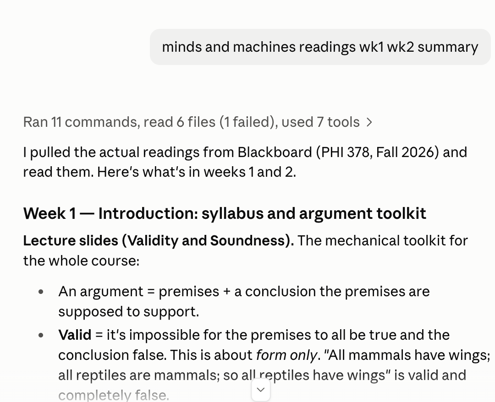

# Blackboard for Claude

Ask Claude about your own Blackboard and get real answers: what's due, your grades, what your
professors posted, and what's inside the files and links they share (PDFs, slides, Google
Docs and Sheets, Colab notebooks, SU videos, and more).

It only sees what you can already see, and it can never submit, post, or change anything.



## Install (about 5 minutes, one time)

Works on a Mac or a Windows PC. Four steps:

1. **Get Claude Desktop.** Download it from [claude.ai/download](https://claude.ai/download),
   install it, open it, and sign in. (It's free for Syracuse students.)
2. **Download this file:**
   [**blackboard-mcp.mcpb**](https://github.com/alanwtom/blackboard-mcp/releases/latest/download/blackboard-mcp.mcpb)
   It goes into your **Downloads** folder.
3. **Open your Downloads folder and double-click `blackboard-mcp.mcpb`.** Claude opens a
   screen called **Blackboard (Syracuse)**.
4. **Click the black Install button.** You will see a red box saying the extension "has not
   been verified by Anthropic" and can access your computer. That is normal for any tool not
   made by Anthropic itself; this one is a student project. It only reads your Blackboard and
   the links your professors post, and it never submits or changes anything.

That's it. The tool also needs Google Chrome or Microsoft Edge on your computer. Windows
already has Edge, and most Macs already have Chrome. If yours doesn't, Claude will tell you
and link you to the free Chrome download.

> Double-click didn't open Claude? In Claude, open **Settings**, click **Extensions**, and drag
> `blackboard-mcp.mcpb` from your Downloads folder into that window.

## The first time you use it

1. In Claude, ask: **"What do I have due this week?"**
2. A new browser window opens with a **red banner** across the top. It may open *behind*
   Claude: if you don't see it, look for a new browser icon in your Dock (Mac) or taskbar
   (Windows) and click it.
3. Sign in there with your NetID and approve Duo, like you always do. The window closes by
   itself when you're done.
4. Ask your question again.

You're done. You only sign in again when Blackboard logs you out, and when that happens the
same red-banner window pops up by itself.

Your password and Duo codes go only into that browser window. Claude never sees them, and
this tool never saves them.

## Things you can ask

- "What's due in the next 7 days?"
- "Anything new in my classes this week?"
- "What are my grades in Oceanography?"
- "Pull up the HW 3 assignment: instructions and attached files."
- "Summarize the Week 3 lecture slides."
- "What's in the Google Sheet my professor linked in the last announcement?"
- "Read the Colab notebook for Lab 0 and explain the first exercise."

Some links need you to be signed in to that site (for example a private Google file or a Zoom
recording). When that happens, a red-banner window opens on the link. Sign in there, close
that tab, and ask again.

## What it can't see

If an answer is missing something, Claude will tell you in that answer, and tell you what to do
instead. The known gaps:

- **Discussion boards, course messages, quiz and test questions, journals, groups,
  attendance.** Not read at all. Open Blackboard for these.
- **Outside tools launched from Blackboard** (McGraw Hill Connect, Gradescope, and similar).
  Their work and deadlines live in that tool, not in Blackboard.
- **Deadlines that exist only in class or in a syllabus file.** "What's due" only knows what
  is posted in Blackboard. Ask it to read the syllabus file if you want those too.
- **YouTube transcripts.** YouTube refuses to give transcripts to automated tools, so you get
  the video's title, channel, length and description. To get the transcript yourself: open the
  video, click "...more" under it, click "Show transcript", and paste it into the chat.
- **Live Zoom meetings.** A class or office-hours link is recognised but never opened.
- **Some grades.** Only grades your instructor has released are visible. "What's new" can miss
  a grade entered on an older assignment; ask for a course's grades to be sure.
- **Google sign-in may be refused.** Google sometimes blocks sign-in from automated browser
  windows. If that happens, ask the professor to share the file as "anyone with the link".
- **Links from outside your courses.** It only opens links a professor posted in one of your
  courses (see Safety below).

## If something goes wrong

| What you see | What to do |
| --- | --- |
| Claude doesn't seem to know about Blackboard | Quit Claude completely and open it again (Mac: Cmd + Q. Windows: right-click the Claude icon near the clock and choose Quit). Then check **Settings → Extensions** shows Blackboard turned on. |
| "Sign in in the window with the red banner" | Find that window (it may be behind Claude), sign in with your NetID and Duo, and ask again. |
| "This computer has neither Google Chrome nor Microsoft Edge" | Install [Google Chrome](https://www.google.com/chrome/) (free), then ask again. |
| "Blackboard is already open in another app" | Another app (like Claude Code) is using Blackboard. Wait a few minutes, or quit that app. |
| A course looks empty | Courses from past terms are locked by the university. New courses may have nothing posted yet. |
| Something else | Ask again. Blackboard has short hiccups sometimes. |

## Update, remove, and privacy

- **Update:** download the file again and double-click it.
- **Remove:** in Claude, open **Settings → Extensions**, find Blackboard, and remove it.
- **Erase your login:** delete the `.blackboard-mcp` folder in your home folder. It holds your
  sign-in and any course files it downloaded, and nothing else. Never share that folder.
- **Everything stays on your computer.** Nothing is sent anywhere except to Blackboard and the
  sites your professors link to.
- **Only your courses' links.** It only opens links a professor posted in one of your courses.
  A web page can hide instructions aimed at the AI; this rule means such a page can never send
  the AI, or your data, somewhere else. Links to your own computer or home network are refused.

## Being a good citizen

Use it for yourself, at a human pace, and check the university's acceptable-use policy before
using any automation with your student account. Not affiliated with or endorsed by Syracuse
University or Anthology/Blackboard.

## Using Claude Code, or setting it up by hand

<details>
<summary><strong>Click to expand: the terminal setup</strong></summary>

You need [Node.js](https://nodejs.org) 22 or newer and git. Then:

**Mac**

```bash
git clone https://github.com/alanwtom/blackboard-mcp.git ~/blackboard-mcp
cd ~/blackboard-mcp
npm run setup
```

**Windows (PowerShell)**

```powershell
git clone https://github.com/alanwtom/blackboard-mcp.git ~\blackboard-mcp
cd ~\blackboard-mcp
npm run setup
```

`npm run setup` checks for a browser (and offers to download one), connects Claude Desktop and
Claude Code, and opens the sign-in window. To update later: `git pull`, then `npm run setup`.

If you already installed the one-click extension, don't also connect Claude Desktop here, or
Blackboard will show up twice.

Other commands: `npm run login` (sign in again), `npm run status`, `npm run courses`,
`npm run connect -- google` (sign in to a site for links), and `npm run logout`.

Doing every step by hand instead:

1. **Install what it needs** (the project comes ready-built, so there is nothing to compile)

```bash
npm install --omit=dev
```

2. **Log in to Blackboard**

```bash
npm run login
```

A browser window opens with a red banner. Sign in with your NetID and approve Duo there. When
you land back on Blackboard, the window closes by itself.

3. **Check that it worked**

```bash
npm run courses
```

4. **Connect your AI app**

For Claude Desktop: open Settings, then Developer, then Edit Config, and add this block
inside the outer braces.

On macOS the config lives at `~/Library/Application Support/Claude/claude_desktop_config.json`:

```json
"mcpServers": {
  "blackboard": {
    "command": "node",
    "args": ["/Users/yourname/blackboard-mcp/dist/index.js"]
  }
}
```

On Windows it lives at `%APPDATA%\Claude\claude_desktop_config.json`:

```json
"mcpServers": {
  "blackboard": {
    "command": "C:\\Program Files\\nodejs\\node.exe",
    "args": ["C:\\Users\\yourname\\blackboard-mcp\\dist\\index.js"]
  }
}
```

Two Windows details matter: **every backslash has to be doubled** (that is how JSON works; a
single backslash makes the file invalid), and giving the full path to `node.exe` avoids the
common case where an app launched from the Start menu cannot find `node` by itself. To print
the two paths you need, run this from the project folder:

```powershell
(Get-Command node).Source; "$PWD\dist\index.js"
```

On macOS, to print both paths, run this from the project folder:

```bash
which node; echo "$PWD/dist/index.js"
```

If Claude Desktop shows no tools even after a full restart, put the `which node` output in
place of `"node"` above: an app opened from Finder does not always inherit the `PATH` your
Terminal has, which is most likely when Node came from `nvm` or Homebrew.

Save the file, quit Claude Desktop completely (Cmd + Q on a Mac; on Windows right-click the
tray icon and choose Quit), and reopen it.

For Claude Code on macOS, run:

```bash
claude mcp add --scope user blackboard -- "$(which node)" /path/to/blackboard-mcp/dist/index.js
```

For Claude Code on Windows, run this from the project folder:

```powershell
claude mcp add --scope user blackboard -- "$((Get-Command node).Source)" "$PWD\dist\index.js"
```

</details>

## For the technically curious

<details>
<summary><strong>Architecture, configuration, and development notes</strong></summary>

- **Stack**: TypeScript (ESM), Node 22+, Playwright driving Chrome, else Edge, else a downloaded Chromium (remembered per machine,
  one dedicated profile folder per browser),
  MCP TypeScript SDK over stdio, Zod, Vitest.
- **Data access**: Blackboard Learn REST API, called as same-origin requests from a page on
  the Blackboard host, so requests match what the Ultra web app itself sends. Both
  `blackboard.syr.edu` and `blackboard.syracuse.edu` (separate cookie domains) are supported.
- **Session resilience**: Learn's session cookie does not survive a browser restart, so the
  authenticated cookie set is snapshotted to `~/.blackboard-mcp/browser-state.json` (mode
  0600 where the OS honours POSIX modes; on Windows the per-user ACL on `C:\Users\<name>`
  does that job) and restored on launch. While the institution SSO session lasts, the SAML
  entry is followed silently to re-authenticate with no interaction.
- **Endpoints** (verified against Syracuse, Aug 2026): `users/me`,
  `users/{id}/courses?expand=course`, course contents (flat listings with `parentId`; file
  data on `contentHandler.file`), course announcements, `calendars/items`, and the v2
  gradebook (`columns`, `columns/{id}/users/me`; due dates at `grading.due`, points at
  `score.possible`). Paging caps at 100. Attachment downloads follow the item's
  `rel=alternate` `/ultra/redirect` link.
- **Tools**: `list_courses`, `get_course_content`, `get_announcements`, `get_assignments`,
  `get_grades`, `get_attachment`, `get_upcoming_work`, `get_recent_updates`,
  `get_assignment_context`, `read_link`. All read-only. Errors are short coded messages with
  sensitive values masked. Long texts come back in pages (`offset` / `next_offset`).
- **Links**: every content item, announcement and assignment carries a `links` list (anchors,
  iframes and plain-text URLs in its HTML, classified by service). `read_link` opens one
  through the same dedicated browser: Google exports (docx/xlsx/pptx), Drive downloads and
  folder listings, Colab via Drive, Kaltura captions captured from the player, Zoom recording
  transcripts from the player's info API (not yet verified against a real recording), Panopto
  SRT, SharePoint `download=1`, GitHub raw/README, and rendered text for everything else. Only
  links seen in the student's own Blackboard data (plus same-site links on an opened page) are
  allowed; private and loopback addresses are refused on every redirect hop.
- **File text**: PDF (pdf.js via `unpdf`), DOCX, PPTX with notes, XLSX with dates (via
  `fflate`), notebooks, and plain text formats, all extracted locally.
- **Low volume**: TTL caching, a 200 ms delay between pages of the same listing, hard
  request caps, and the shared browser closes after 5 idle minutes. Independent work (one
  course versus another, one gradebook column versus another) runs at most four requests
  deep via `mapWithConcurrency`, so the request *count* is unchanged — they are simply no
  longer queued behind each other. Courses that answer `PERMISSION_DENIED` are remembered
  for 15 minutes, which removes them from later sweeps entirely: past-term enrolments are
  reported as available and only refuse when their contents are asked for, and Blackboard
  publishes no end date to tell them apart beforehand.
- **Configuration**: `BB_BROWSER_CHANNEL`, `BB_HEADLESS=0`, `BLACKBOARD_MCP_HOME`,
  `BB_BASE_URL`, `BB_SSO_ENTRY_URL`, and `BLACKBOARD_HOSTS` in `src/blackboard/hosts.ts`
  for other institutions.
- **One-click extension**: `npm run bundle` builds `release/blackboard-mcp.mcpb` (about 7 MB):
  the built code, runtime packages only, and `extension/manifest.json`. Claude Desktop runs it
  with its own built-in Node (24 as of Sep 2026; the manifest requires 22+). Attach it to a
  GitHub release under exactly that file name so the "latest" download link keeps working.
  With no sign-in, the server itself opens the NetID window. With no Chrome or Edge, a
  terminal install downloads Playwright's Chromium in the background; inside Claude Desktop
  (which runs extensions in its own Electron process, where spawning "node" would start the
  Claude app itself) the student is asked to install Chrome instead.
  `BB_PRETEND_NO_BROWSERS=1` simulates a machine with neither.
- **Shipped build**: `dist/` is committed so terminal installs get only runtime packages (about
  44 MB) and never compile anything. After changing `src/`, run `npm run build` and commit
  `dist/` too; a test fails if it is out of date. `npm run setup` removes dev tools from
  `node_modules`, so run `npm install` again before developing.
- **Development**: `npm run typecheck`, `npm test` (fully mocked), `npm run build`,
  `npm start`, and `npm run discover` (records real Blackboard traffic while you browse, to
  verify endpoints).
- **Platforms**: macOS, Windows 10/11, and Linux are supported. Linux was tested on Ubuntu 24.04
  (the full test suite, the MCP server, and a headless Chromium launch). A fresh Linux machine
  may need the Chromium system libraries once: `sudo npx playwright install-deps chromium`. Everything OS-specific lives in `src/platform.ts` (Chrome and Claude Desktop
  locations, PATH lookup, spawning `.cmd` shims). Three Windows behaviours the code handles
  explicitly:
  - Downloaded file names are sanitized to Windows rules on every platform. A Blackboard file
    called `Week 3: Notes.pdf` would otherwise land in an NTFS alternate data stream on a file
    named `Week 3` — reported as a successful download the student can never open.
  - A locked browser profile announces itself differently: Windows Chrome exits with code 21
    and Playwright only sees the control pipe close, so that signature maps to
    `BROWSER_PROFILE_BUSY` alongside the POSIX `SingletonLock` message.
  - `where` lists the extensionless npm shim ahead of the runnable `.cmd`, so PATH lookups
    prefer a PATHEXT match, and `.cmd` shims are spawned through `cmd.exe` with quoted
    arguments (project paths often contain spaces).
- **Compatibility**: built for Syracuse University Blackboard Ultra, Aug 2026. Other schools
  need the configuration above plus small parser checks.

</details>

## License

[MIT](LICENSE). Made for students, by a student.
